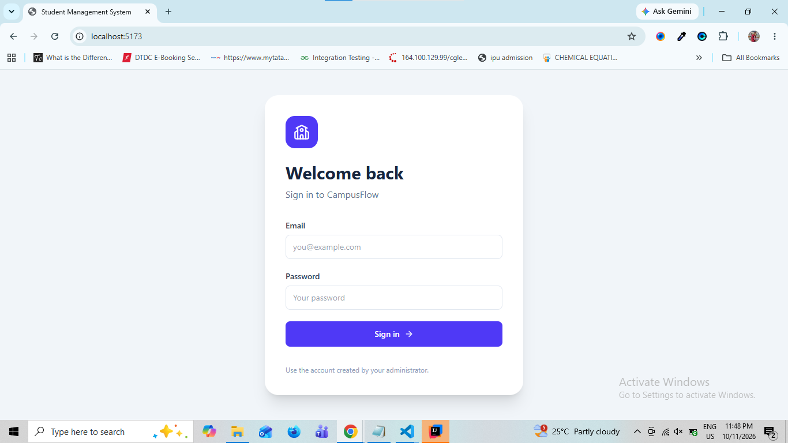
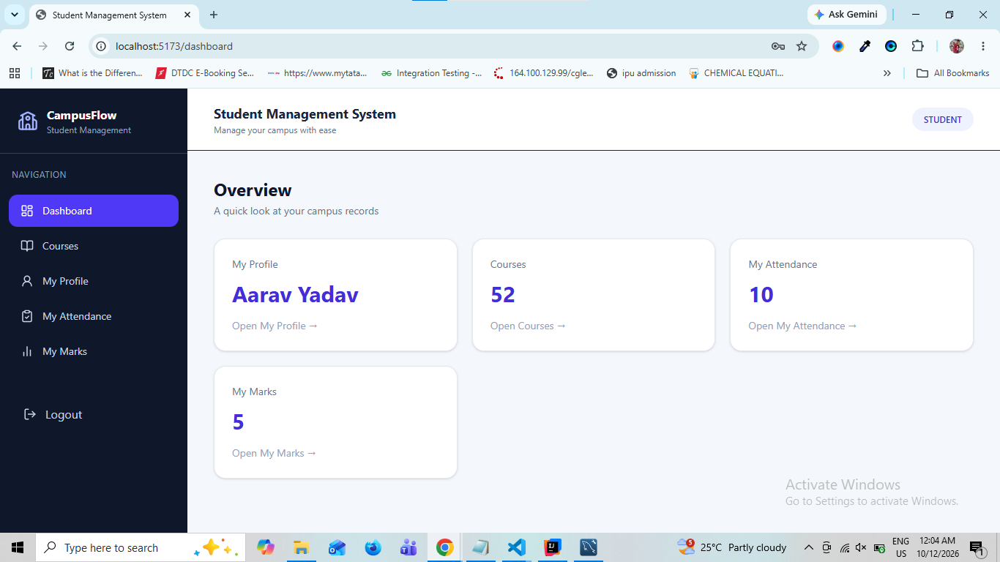

# Student Management System (SMS)

A full-stack Student Management System built with **Java, Spring Boot, React, and MySQL**. It provides a centralized application for managing student records, teachers, courses, attendance, and academic marks with role-based access control.

## Tech Stack

| Layer | Technologies |
| --- | --- |
| Frontend | React.js, Tailwind CSS, JavaScript |
| Backend | Java 17, Spring Boot, Spring Web, Spring Security |
| Database | MySQL, Spring Data JPA, Hibernate |
| Authentication | JWT, BCrypt password hashing, role-based authorization |
| Development tools | Maven, Git, GitHub, Postman |

## Features

- Secure authentication using JWT and password hashing.
- Role-based access for **Super Admin**, **Teacher**, and **Student**.
- Student profile management and CRUD operations.
- Teacher and course management.
- Attendance and marks management.
- REST APIs connecting the frontend and backend.
- Responsive dashboard-style interface.

## User Roles

| Role | Main responsibilities |
| --- | --- |
| Super Admin | Manage users, students, teachers, and courses |
| Teacher | Work with student attendance and marks |
| Student | Access student-related academic information according to permissions |

> Exact permissions depend on the security rules configured in your project.

## Project Structure

The repository may contain separate frontend and backend directories:

```text
student-management-system/
├── student-management-backend/        # Spring Boot REST API
├── student-management-frontend/       # React application
├── screenshots/
└── README.md
```

> Adjust the folder names above to match your GitHub repository.

## Getting Started

### Prerequisites

- Java 17 or newer (compatible with your Spring Boot version)
- Maven (or the Maven wrapper included in the backend)
- MySQL
- Node.js and npm

### 1. Clone the repository

```bash
git clone https://github.com/YOUR_USERNAME/SMS-Java.git
cd SMS-Java
```

Replace the placeholder URL with your actual SMS repository URL.

### 2. Configure the database

Create a MySQL database:

```sql
CREATE DATABASE student_management_system;
```

Configure the backend's `application.properties` or `application.yml` using your actual database name and credentials. For example:

```properties
spring.datasource.url=jdbc:mysql://localhost:3306/student_management_system
spring.datasource.username=${DB_USERNAME:root}
spring.datasource.password=${DB_PASSWORD:}
spring.jpa.hibernate.ddl-auto=update
```

Use environment variables for passwords and JWT secrets. **Do not commit credentials or secret keys.**

### 3. Run the backend

From your backend folder:

```bash
./mvnw spring-boot:run
```

On Windows, use `mvnw.cmd spring-boot:run`. If the repository does not include a Maven wrapper, use `mvn spring-boot:run`.

The API runs on `http://localhost:8080` if you use the default port.

### 4. Run the frontend

From your frontend folder:

```bash
npm install
npm run dev
```

Open the local URL printed by the development server (often `http://localhost:5173` for Vite).

Configure the frontend API base URL to match your backend configuration.

## Example API Routes

The backend includes student management endpoints such as:

| Method | Endpoint | Purpose |
| --- | --- | --- |
| `GET` | `/api/students` | List students |
| `GET` | `/api/students/{id}` | Get a student by ID |
| `POST` | `/api/students` | Create a student |
| `PUT` | `/api/students/{id}` | Update a student |
| `DELETE` | `/api/students/{id}` | Delete a student |

Additional authentication, teacher, course, attendance, and marks routes depend on the controllers in your backend. Protected endpoints require an appropriate JWT and role.

## Screenshots

### Login Page


### Super Admin Dashboard


### Student Dashboard


### Teacher Dashboard


## Future Improvements

- Pagination, search, and advanced filtering.
- CSV or Excel export for academic records.
- Automated API and frontend tests.
- Deployment and environment-specific configuration.

## Author

**Shivam Pandey**  
GitHub: [ShivamPandey-FSD](https://github.com/ShivamPandey-FSD)  
LinkedIn: [Shivam Pandey](https://www.linkedin.com/in/shivam-pandey-37779934a/)

---

**Note:** Update placeholder repository paths, configuration values, and screenshots to match your codebase before publishing.
